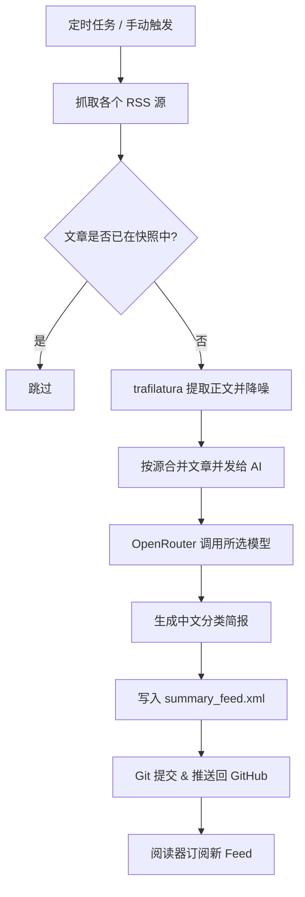

# 🤖 SummaRSS - RSS AI Daily Summarizer

<a href="http://validator.w3.org/feed/check.cgi?url=https%3A//raw.githubusercontent.com/liusonwood/SummaRSS/main/summary_feed.xml"></a>

这是一个基于 **GitHub Actions + OpenRouter** 的自动化 RSS 摘要生成器。它定时抓取你指定的 RSS 订阅源，用 `trafilatura` 提取每篇文章的正文，调用 AI 模型把多篇新文章合并为一份中文分类简报，并发布为兼容 RSS 2.0 的新订阅源，供 Reeder、NetNewsWire 等阅读器订阅。



---

## ✨ 核心特性

*   **📡 多源聚合**：可同时监控多个 RSS 源，每个源独立生成一条简报，在输出 RSS 中作为不同条目呈现。单个源抓取或处理失败不会影响其他源。
*   **⚡ 无服务器运行**：订阅内容保存在仓库的 `summary_feed.xml` 中，运行环境是 GitHub Actions，无需维护服务器或数据库。
*   **🔄 增量处理与去重**：每个源的去重快照保存在 `processed.txt` 中，只处理快照之外的新文章，节约 API 额度。该文件保存在 Actions Cache 中，而不是提交到仓库。
*   **🧼 正文降噪**：使用 `trafilatura` 分析网页结构，剥离侧边栏、广告和导航栏等内容，只把正文交给 AI。
*   **🤖 合并分类摘要**：把一批文章合并为一份按主题分类、按重要程度排序的简报，并转换为阅读器兼容的 HTML。
*   **🛡️ 网络容错**：调用 OpenRouter 时对 429、408、5xx 及网络错误进行重试，其他错误直接放弃。

---

## 🚀 快速开始

### 方案 A：GitHub Actions 自动化部署（推荐）

#### 1. Fork 并克隆本仓库
首先将本仓库 Fork 到你自己的 GitHub 账号下。

#### 2. 开启 Actions 写入权限（重要 ⚠️）
为了让 GitHub Actions 能把生成的 RSS 文件推回你的仓库，需要进行以下配置：
1. 进入仓库设置：`Settings -> Actions -> General`。
2. 滚动到页面底部找到 **Workflow permissions**。
3. 选择 **Read and write permissions** 并保存。

> [!WARNING]
> 如果不开启此权限，运行 Actions 时会出现 `Permission to ... denied to github-actions[bot]` 报错。

#### 3. 配置 Repository Secrets
进入 `Settings -> Secrets and variables -> Actions`，点击 `New repository secret` 添加以下变量：

| 变量名 | 类型 | 是否必填 | 说明 | 示例值 |
| :--- | :--- | :--- | :--- | :--- |
| `OPENROUTER_API_KEY` | Secret | **是** | OpenRouter API 密钥 | `sk-or-v1-xxxx...` |
| `RSS_SOURCE` | Secret | 否 | 要监控的 RSS 源地址，多个源用英文逗号分隔。未设置时默认使用 `https://9to5mac.com/feed/` | `https://9to5mac.com/feed/,https://techcrunch.com/feed/` |
| `AI_MODEL` | Secret | 否 | 使用的 AI 模型，默认 `google/gemini-2.0-flash-001` | `google/gemini-2.0-flash-001` |
| `OPENROUTER_API_ENDPOINT` | Secret | 否 | OpenRouter API 端点，默认 `https://openrouter.ai/api/v1/chat/completions` | `https://openrouter.ai/api/v1/chat/completions` |

此外还有几个可选的环境变量，可以在工作流中设置，用于调整运行参数：

| 变量名 | 默认值 | 说明 |
| :--- | :--- | :--- |
| `MAX_HISTORY_ITEMS` | `25` | 输出 RSS 中保留的最大条目数，超出部分自动删除 |
| `MAX_WORKERS` | `4` | 并发处理的 RSS 源数量上限 |
| `ARTICLE_WORKERS` | `6` | 单个源内并发抓取文章的线程数 |
| `ARTICLE_TIMEOUT` | `15` | 单篇文章抓取的超时时间（秒） |

#### 4. 激活订阅
*   GitHub Actions 的定时任务配置为**每天北京时间 07:35 运行**（UTC 23:35）。
*   也可以在 **Actions** 选项卡中手动触发 `RSS AI Summary` 工作流。
*   运行成功后，可以用下面的地址订阅你的个人 AI 简报源：
    ```text
    https://raw.githubusercontent.com/{你的用户名}/{你的仓库名}/main/summary_feed.xml
    ```

---

### 方案 B：本地开发与调试

#### 1. 安装依赖
```bash
pip install -r requirements.txt
```

#### 2. 设置环境变量并运行
```bash
export OPENROUTER_API_KEY="your_openrouter_api_key"
export RSS_SOURCE="https://9to5mac.com/feed/,https://techcrunch.com/feed/"
export AI_MODEL="google/gemini-2.0-flash-001"
export OPENROUTER_API_ENDPOINT="https://openrouter.ai/api/v1/chat/completions"

python3 summarize.py
```

本地运行时不会执行 git 推送，生成的 `summary_feed.xml` 会保留在当前目录。

---

## 🛠 技术细节

*   **多模型兼容**：基于 OpenRouter 接口，可以把 `AI_MODEL` 换成其他模型，例如 `anthropic/claude-3.5-sonnet` 或 `deepseek/deepseek-chat`。
*   **网络重试**：调用 OpenRouter 失败时最多尝试 3 次；服务端返回 `Retry-After` 时会按其等待，上限 60 秒。401、400、404 等客户端错误不会重试。
*   **单次文章上限**：每次运行每个源最多抓取 `50` 篇新文章（`MAX_ITEMS`），超出部分不会被处理。
*   **历史保留**：输出的 RSS 默认保留最近 `25` 条简报条目（可通过 `MAX_HISTORY_ITEMS` 修改），超出的旧条目会自动删除。
*   **标准规范**：输出中包含 `atom:link` 自引用，时间使用 RFC 822 格式，便于通过 RSS 校验。

---

## ⚖️ License

[MIT](LICENSE)
